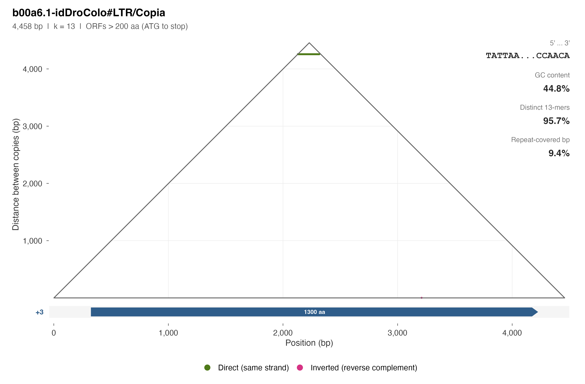
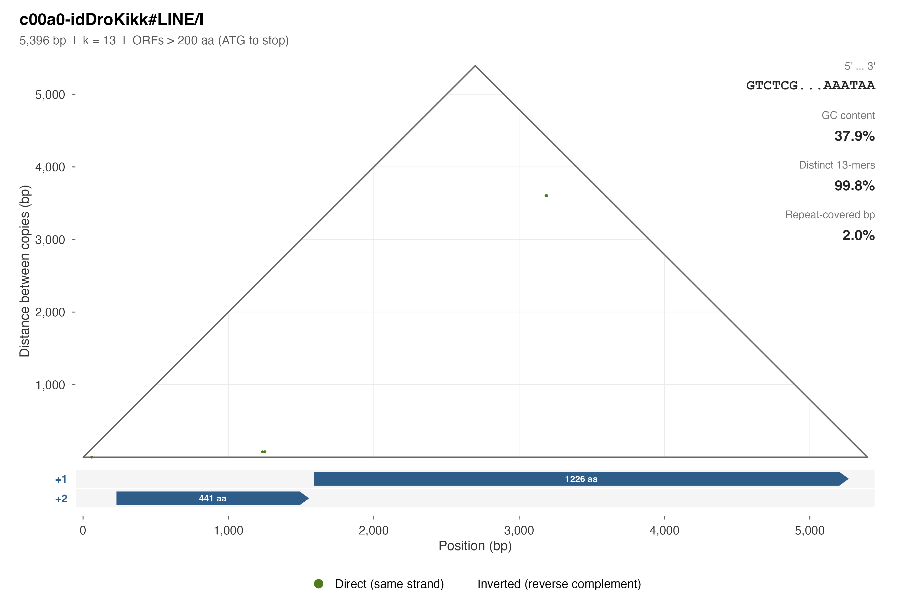
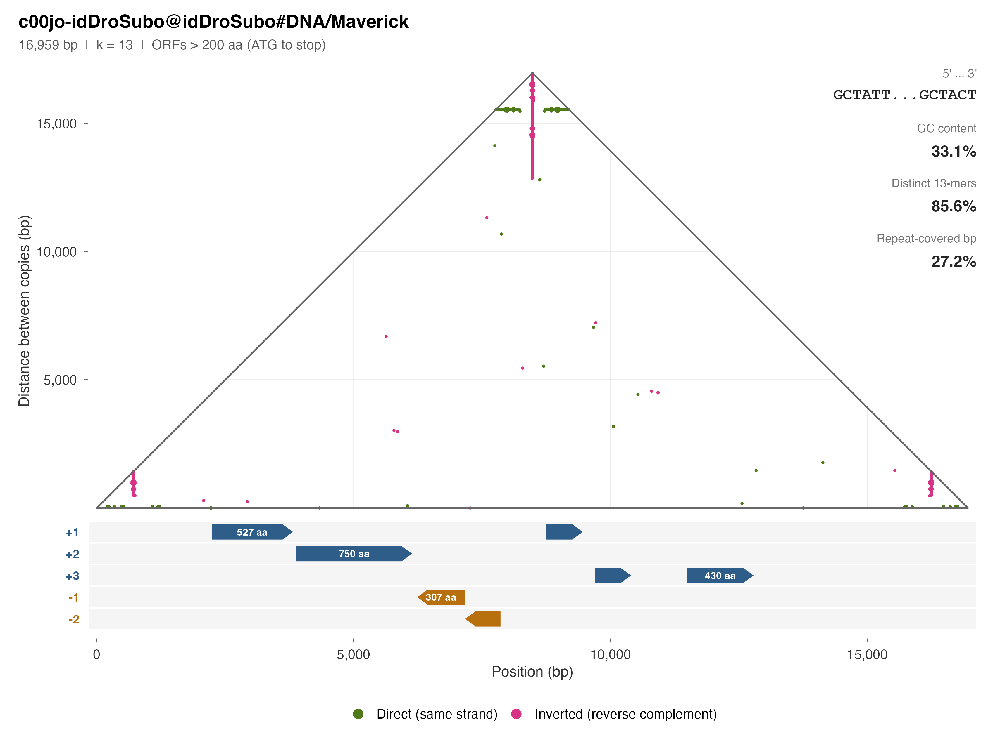

# TEplot

Basic structural plots for transposable elements (TEs) in a FASTA file.

For each sequence, TEplot draws a self-dotplot as a triangle (the upper half
of the dotplot rotated 45°), with:

- **Direct repeats** (e.g. LTRs) as horizontal lines, and **inverted repeats**
  (e.g. TIRs) as vertical lines
- **ORFs** longer than 200 aa underneath, one lane per reading frame that
  contains an ORF; + and − strands in different colours
- The **sequence ends**, **GC content** and two **complexity** measures:
  distinct k-mers and repeat-covered bases

## Requirements

R with the packages `data.table`, `stringi` and `ggplot2` (missing packages are
installed on first run).

## Usage

```
Rscript TEplot.R fasta_file kmer_size output_folder
```

Or make the script executable:

```
chmod +x TEplot.R
./TEplot.R fasta_file kmer_size output_folder
```

## Example

```
Rscript TEplot.R library.fa 13 plots/
```

Smaller k-mer sizes (8–10) detect shorter or more diverged repeats but add
noise; larger sizes (13–20) show only clear repeats.





## Settings

Colours, dot size, the minimum ORF length, whether ORFs must start with ATG,
and the plot style (`"triangle"` or `"square"`) can be changed at the top of
`TEplot.R`.

Claude helped with some rough edges. 

